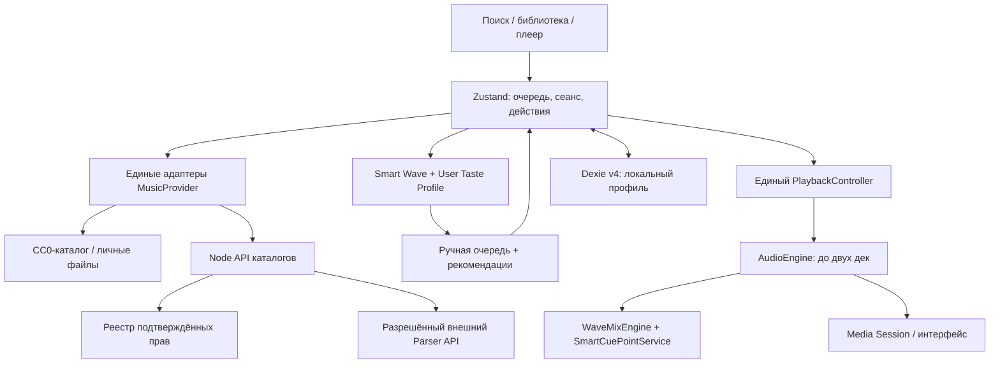

# Архитектура NoteSoundbot 2.0

## Основа проекта

Frontend: React 19, TypeScript, Vite, HashRouter, Zustand, TanStack Query, Dexie/IndexedDB, Motion и собственные CSS-стили Liquid Glass. Сохранены навигация, библиотека, импорт/экспорт, избранное, плейлисты и оформление. Статический frontend остаётся на GitHub Pages; необязательный API каталогов — отдельный Node.js-сервис без дополнительных runtime-зависимостей.

## Карта модулей

| Задача | Основные файлы |
|---|---|
| Track, права, сигналы и настройки | `src/types/music.ts`, `src/lib/settings.ts` |
| MusicProvider, поиск, доступность и дедупликация | `src/adapters/music/index.ts`, `src/lib/normalize.ts` |
| Собственный каталог | `src/adapters/music/catalog.ts`, `public/audio/` |
| HitmozProvider / LicensedAudioProvider | `src/adapters/music/hitmoz.ts`, `licensed.ts` |
| Граница парсера и реестр прав | `server/catalog-model.mjs`, `server/index.mjs` |
| Авторизация, лимиты, проверка адресов | `server/security.mjs` |
| Единый транспорт и AudioEngine | `src/services/playback/controller.ts`, `src/services/audio/controller.ts` |
| Подбор и очередь | `src/features/wave/engine.ts`, `recommendation.ts`, `queue.ts` |
| Вкусы и воспроизводимый RNG | `src/features/taste/profile.ts` |
| Web Audio и музыкальные метки | `src/features/mix/engine.ts`, `cue-points.ts` |
| История, сеанс и интеграция событий | `src/store/music.ts` |
| Хранилище и миграции | `src/services/storage/db.ts` |
| Telegram и safe area | `src/services/telegram/index.ts` |
| Плеер, очередь и настройки | `src/components/Player.tsx`, `TrackList.tsx`, `src/pages/Settings.tsx` |
| Необязательная доставка аудио | `server/telegram-audio.mjs` |

История, предпочтения и сеанс используют существующие store/таблицы; пустые сервисы ради названий из ТЗ не добавлялись.

## Граница доверия

Track содержит стабильный ID, источник, название/исполнителя, длительность, обложку, оригинальную ссылку, известную популярность, `availability`, `playbackMode`, `rights`, необязательные `audioSource` и `cuePoints`. Метаданные без прав имеют режим `metadata` и исключаются из воспроизведения/Волны. Поле `download` парсера не становится аудиоисточником.

Frontend обращается к собственному API, который нормализует JSON парсера. Воспроизведение требует отдельной канонической записи реестра. Сервер проверяет URL, HEAD и Content-Type, но не скачивает и не проксирует музыкальные файлы. Обход защиты и извлечение YouTube-аудио отсутствуют.

## Аудио и жизненный цикл

Один PlaybackController владеет активным источником. Обычно звучит одна HTMLAudio-дека; вторая подготавливает следующую запись. Только во время Wave Mix звучат две. Общий AudioContext создаётся по необходимости, элементы/узлы переиспользуются, старые ресурсы освобождаются. Неподходящий для Web Audio источник сохраняет обычное HTMLAudio-воспроизведение.

Отмена и ревизии запросов не дают старому поиску или `play()` возобновить отменённую песню. Пауза во время Mix останавливает обе деки; ручной переход отменяет микс. Основная запись и Media Session меняются в середине перехода. `listened` учитывает только достоверное движение позиции; seek, пауза и замороженный WebView не создают фиктивного слушания.

YouTube оставлен под `VITE_LEGACY_YOUTUBE_ENABLED=true` для временного отката; по умолчанию выключен. При включении используется официальный видимый iframe с тем же транспортом, без скрытого аудиорежима.

## Данные и авторизация

Dexie v4 добавляет тип очереди, `tasteSignals` и `trackCuePoints`, сохраняя существующие таблицы. Настройки Wave/Mix и снимок воспроизведения лежат в `settings`, фактическая история — в `history`, активная Волна — в `waveHistory`. Восстановление не включает звук автоматически.

Telegram использует локальную базу `notesound-music-tg-<id>`, обычный браузер — `notesound-music`. Старую базу копирует только первый назначенный Telegram-профиль; исходник не удаляется, повторная миграция не возвращает удалённые пользователем записи. ID из `initDataUnsafe` используется только для локального разделения. Сервер независимо проверяет подписанный `initData`, затем выдаёт ограниченный по времени и Origin сеанс, который frontend хранит только в памяти. BOT_TOKEN остаётся на сервере.

Сервер использует точные HTTPS allowlist, запрет частных IP, проверку DNS с привязкой адреса к соединению, запрет redirect, лимиты размеров/времени, кеш и ограниченную параллельность. Серверной базы предпочтений и синхронизации между устройствами нет.
