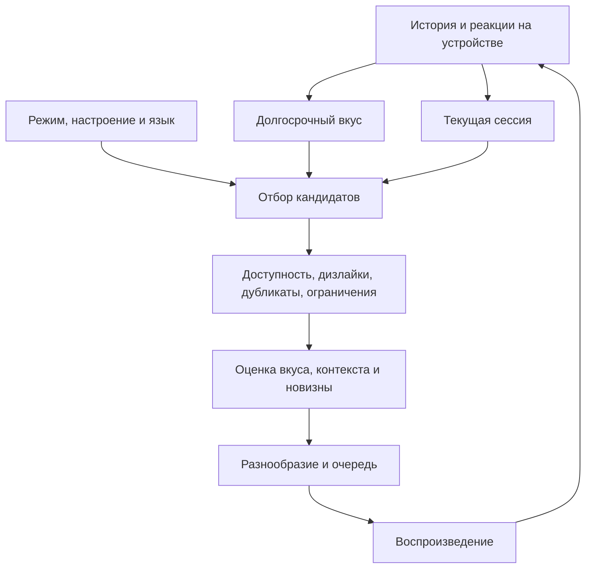

# Персональная «Моя волна» NoteSound

Это собственный рекомендательный движок NoteSound по принципам из приложенного
описания: отбор кандидатов → ограничения → оценка интереса → разнообразная
последовательность → новая обратная связь. Это не копия весов или исходного кода
Яндекс Музыки.

## Что изменилось для слушателя

- Большой Play на вкладке Волны включает новую рекомендацию. Пауза и продолжение
  текущей записи находятся в обычном плеере. Подготовленная очередь используется
  первой, текущая запись и её альтернативные публикации исключаются.
- Волна учитывает избранное, лайки, фактические дослушивания, намеренные повторы
  и пропуски, а не только имя последнего исполнителя.
- Долгосрочный вкус и последние реакции оцениваются отдельно. Несколько пропусков
  рока могут изменить текущий поток, сохранив давнюю любовь к рок-музыке.
- «Настроить волну» открывает режимы «Баланс», «Любимое», «Незнакомое», выбор
  настроения и языка. Настройки сохраняются на устройстве.
- Новые реакции сразу пересортировывают подготовленные автоматические треки.
  Ручная очередь и звучащая композиция сохраняются.
- Дизлайк исключает запись, включая публикацию другого источника и перестановку
  исполнителей в совместной песне. Новый лайк может отменить старый дизлайк.
- Без интернета используются реально сохранённые аудиофайлы, без обращений
  к музыкальным источникам. Удалённый файл не выбирается по оставшемуся избранному.

## Конвейер

### 1. Данные и профиль

События сохраняются в `tasteSignals`, реальное прослушивание — в `history`.
Профиль включает оценки записей, исполнителей и реальных жанровых тегов.
Количество событий ограничено, оценки насыщаются, старые неявные реакции
постепенно ослабевают. Явные предпочтения сохраняются до изменения слушателем.

У сессионных оценок период полураспада 25 минут и окно до трёх часов. Пропуск
ослабляет ближайшие похожие рекомендации, но не создаёт постоянный запрет на
исполнителя или жанр. Будущие и повторно переданные события не засчитываются.

Дослушивание подтверждается после 70% фактически проигранного времени.
Перемотка не добавляет это время. Повтор учитывается как положительная реакция
при намеренном повторном выборе ранее достаточно прослушанного трека;
автоматический цикл плейлиста не выдаёт себя за предпочтение пользователя.

### 2. Получение кандидатов

Используются независимые направления: текущая сессия, любимые исполнители,
похожие жанры, поиск открытий и доступные чарты источников. Полная первая
страница одного исполнителя не прекращает расширение пула. При отсутствии
жанровых тегов используются также реальные связи по участникам совместных записей.

Первый трек нового запуска проходит тот же фильтр и ранжирование. При пустой
истории используются подключённый каталог и доступные настройки. Явный неудачный
запрос не подменяется случайной демонстрационной песней.

Один подбор ограничен четырьмя логическими операциями каталога и общей
длительностью 30 секунд. Логическая операция может обращаться к нескольким
адаптерам. Отмена распространяется на устаревшие запросы; повторяющиеся токены
страниц не создают бесконечный цикл. Метаданные личных файлов не используются
для внешних поисковых запросов.

### 3. Фильтры и выбор последовательности

Исключаются недоступные записи, фрагменты-превью, запрещённые записи,
дубликаты текущей и уже добавленной музыки. Поддерживаются доступные полные
потоки источников, собственные записи и личные файлы. Права на скачивание
или сведение при этом не расширяются.

Оценка сочетает долгосрочный вкус, свежие реакции, сходство жанровых признаков,
выбранные настройки и новизну. Это прозрачное локальное ранжирование, а не
заявление об обученной нейросети или калиброванных вероятностях лайка.

Базовое распределение причин подбора — похожее / персональное / открытие /
популярное. «Любимое» сдвигает выбор к знакомым артистам, «Незнакомое» — к ещё
не слышанным исполнителям. Причина указывается только при наличии соответствующих
данных. Повторение записей и соседних исполнителей ограничивается; мягкие
ограничения постепенно ослабляются в маленьком каталоге. Дизлайки и известные
противоречия выбранному языку или настроению не ослабляются.

### 4. Обратная связь и устойчивость

Автоматический подбор поддерживает целевой размер семь записей с учётом ручной
очереди. Ручные добавления не обрезаются. При малом остатке готовится продолжение.
Лайк, пропуск или смена настроек
немедленно пересортировывают готовые варианты; обновление внешнего пула
запускается с короткой задержкой, объединяющей частые действия.

Во время загрузки новая выдача не обнуляет старую. Устаревший ответ не может
вернуть запрещённую запись или отменить новое действие. Смена настроек во
время поиска первой песни отменяет старый поиск и запускает актуальный.

### 5. Отзывчивость запуска и фоновая подготовка

Первая песня запускается без ожидания полной будущей очереди. Если готового
варианта пока нет, запрашивается только одна новая запись; до её готовности
звучащая песня продолжает играть. Неудачный поиск не возобновляет старую
приостановленную запись под видом нового запуска Волны.

Подбор продолжения начинается после подтверждённого начала аудио, с небольшой
отсрочкой и в свободное время браузера. Запрос готовит не больше двух следующих
записей, передаёт их по мере готовности и затем постепенно пополняет очередь
до семи. Фоновый подбор не блокирует большой Play. Пауза, другой выбор трека
или остановка отменяют устаревшую работу. Один и тот же ближайший аудиоисточник
не подготавливается повторно при каждом небольшом обновлении очереди.

В пределах одного запроса переиспользуются профиль, нормализованные признаки
и индексы записей. Оценки кандидатов вычисляются один раз, а не повторяются
в каждой сортировке и на каждом месте очереди. Оболочка приложения и кнопка
Волны больше не перерисовываются из-за каждого изменения позиции плеера.
При восстановлении приложения одинаковые записи обрабатываются один раз,
а реакции читаются по индексу времени в пределах последних 5000 событий.

Диагностический синтетический замер на этом компьютере: 5000 реакций,
1000 записей истории и 300 кандидатов — примерно 9,8–12,2 секунды до
оптимизации и 61–91 мс после неё, с теми же выбранными семью записями.
Это время вычислений; загрузка музыки и ответы внешнего каталога в него
не входят. Отдельный диагностический тест запускается с `RUN_WAVE_BENCHMARK=1`.

### 6. Знакомые песни и новые исполнители

Новая запись знакомого артиста больше не считается открытием нового исполнителя.
Для открытия все участники записи должны отсутствовать в истории, реакциях,
избранном и ближайшей очереди. Совместная песня со знакомым артистом сама по себе
этому условию не соответствует.

В режиме «Баланс» после трёх песен без нового исполнителя следующий подбор
резервирует место для открытия; в «Незнакомом» интервал сокращён до одной.
Счётчик учитывает и уже подготовленную очередь, поэтому небольшие фоновые
запросы не обнуляют разнообразие. В режиме «Любимое» обязательного открытия нет.
Если источник не дал подходящего доступного кандидата, остаётся знакомая музыка.

Для расширения используются реальные совместные публикации и метаданные похожих
артистов Deezer. Имена затем ищутся в основном каталоге: фрагменты Deezer не
подменяют полные записи. Поиск открытий выполняется в пределах общего бюджета
запроса, в фоне; обычный быстрый путь не ждёт его на каждом треке. Отсутствие
метаданных или ошибка дополнительного сервиса не останавливают доступную очередь.

История поиска браузера, Google и других приложений не читается. Персонализация
опирается на прослушивания и реакции внутри NoteSound.

## Практические границы

У текущего публичного каталога часто отсутствуют жанр, язык вокала и настроение.
Название, обложка или поисковая фраза не превращаются в выдуманные свойства
аудио. Настройки направляют поиск, известные теги влияют на фильтрацию и оценку;
записи с неизвестными признаками остаются допустимыми. Поэтому строгий подбор
по настроению и языку зависит от качества данных источника.

В этой версии нет данных о поведении других слушателей, коллаборативной модели,
ARGUS/Sona, анализа звучания или текстов. Их добавление потребует отдельного
набора данных и инфраструктуры обучения. Локальные реакции не отправляются
для облачного обучения; внешним источникам передаются поисковые запросы.

## Основания архитектуры

- [Яндекс: устройство режима «Незнакомое» и рекомендательного конвейера, 2024](https://habr.com/ru/companies/yandex/articles/845680/).
- [Яндекс: ARGUS и последовательности пользовательских событий, 2025](https://habr.com/ru/companies/yandex/articles/919058/).
- [Sona Technical Report, 2026](https://arxiv.org/abs/2608.11015).

Публикации описывают значительно более крупную ML-инфраструктуру. В NoteSound
воспроизведены доступные принципы организации и поведения рекомендаций.

## Проверка

Тесты охватывают профиль, текущую сессию, смену режимов, отмену дизлайка,
ограничения повторов, разнообразие, отсутствие интернета, отмену устаревших
запросов, сохранение ручной очереди и отсутствие ложных дослушиваний от перемотки.
Настройки дополнительно проверяются в браузере на реальном интерфейсе приложения.
